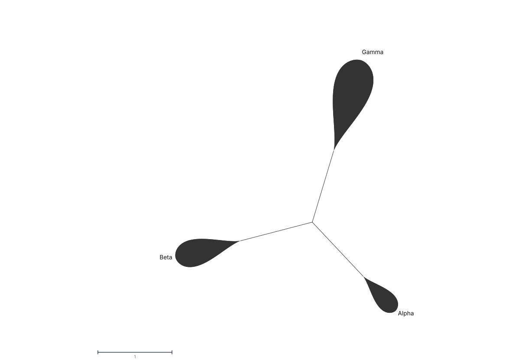

# Optimize a radial tree with area-sized petals

Use `view.optimize-petal-layout` to arrange collapsed clades as petals whose
filled polygon area is proportional to a supplied numeric attribute. Run this
workflow in a TreeViz build that lists the command in `api.commands()`.



The command runs a seeded layout search once. It saves node coordinates, petal
angles, scaled areas and sizing settings in the session. Panning, changing
colors and reopening the session do not repeat the search. It is one
undoable edit.

The command runs on the browser's main thread. A work budget rejects large
searches before changing the session. Reduce `steps` or collapse more of the
tree if the command reports that the search is too large.

## Supply clade values and collapse the clades

The area attribute must have a finite, nonnegative value for every outermost
collapsed clade. It can come from direct node attributes or bound node metadata.
Values on hidden clades or nested collapses are not used. Zero means zero filled area;
missing, negative and nonnumeric values make the command fail without changes.

This example uses arbitrary values, not calculated phylogenetic diversity:

```javascript
const api = window.__treeviz
await api.execute('session.import-tree', {
  source: '((A:1,B:1)Alpha:1,(C:1,D:1)Beta:1,(E:1,F:1)Gamma:1);',
  name: 'Petal example'
})
await api.execute('session.import-node-metadata', {
  tsv: 'clade\tarea_value\nAlpha\t1\nBeta\t2\nGamma\t4',
  rowKeyColumn: 'clade'
})
for (const name of ['Alpha', 'Beta', 'Gamma']) {
  const node = api.findNodes({ regex: `^${name}$`, kind: 'internal' })[0]
  await api.execute('tree.collapse-clade', { stableKey: node.stableKey })
}
```

## Optimize and inspect

```javascript
const result = await api.execute('view.optimize-petal-layout', {
  areaAttribute: 'area_value',
  areaScale: 0.1,
  aspect: 0.4,
  seed: 53,
  steps: 2000,
  clearance: 0,
  labelUnit: 0
})
if (!result.ok) throw new Error(result.error.message)
console.log(result.value)
const settled = await api.whenSettled()
console.log(api.getLayoutMetrics())
console.log(api.getDiagnostics())
console.log(settled.renderDiagnostics)
```

`areaScale` is squared layout units per attribute unit. With branch lengths
shown, layout units are branch-length units; with a cladogram, each edge has
unit length. The example requests filled areas 0.1, 0.2 and 0.4. `aspect` is
maximum width divided by length. Both dimensions change together, so doubling
the value doubles area, not length. Area excludes the outline stroke.

The search starts from a petal-aware equal-angle and equal-daylight layout,
then rotates subtrees and bends petals by at most five degrees. A last pass
checks the exact petal outlines and bends a petal that still touches another
petal or a foreign branch. Before the search, the drawing is turned so that its
longest direction is horizontal; a wide tree then uses the width of the stage,
because a petal figure is fitted by its bounding box. The search preserves
tree topology, stored branch lengths and glyph area. It replaces any previously
imported drawing coordinates. It does not infer a phylogeny, calculate the
area attribute or guarantee zero overlaps.

The result contains `initialScore`, `finalScore`, `acceptedMoves` and
`petalCount`. The score uses nine disks to approximate each petal during the
search and normalizes distances to the visible geometry's scale. Disk overlap
is only an approximation, especially for wide petals. Check the final polygons with `wedgeOverlapPairs`,
`wedgeBranchCrossings` and label metrics, then inspect an exported image. Different seeds give different layouts, so
compare a few when conflicts remain. Set `labelUnit` to the layout units per
label pixel to make the search keep room past each petal tip for a horizontal
label; a value near one divided by the pixels per layout unit of the final
figure is a good start. The renderer then seats the text. Existing clade
backgrounds indicate groups and do not carry the area encoding.

## Shorten a long branch

A few long branches can use most of the stage. `tree.set-branch-break` draws
one branch at a fraction of its length in radial layout and marks it with two
slanted strokes. The stored branch length does not change. Set the breaks
before the optimizer runs, because a changed break makes saved petal
coordinates invalid.

```javascript
const stem = api.findNodes({ regex: '^Gamma$', kind: 'internal' })[0]
await api.execute('tree.set-branch-break', { stableKey: stem.stableKey, fraction: 0.3 })
// fraction: null removes the break
```

State in the figure caption that marked branches are not to scale. Rerooting
removes every break, because the marked branch no longer exists in the same
form.

## Add a legend

A petal figure is fitted to the stage by its bounding box. With
`labelOrientation: 'horizontal'` and `labelDeclutter: true`, labels of
collapsed clades sit beside their petals, so no ring is kept around the tree
for them. Instead the fit keeps room for each petal's own label on the side its
tip points to, up to a fifth of the stage per label, and the label search avoids
a seat outside the fitted frame. Other label settings, and a label on an expanded clade, still
reserve a ring. Leave room
for legends yourself: place each legend section with
`view.set-figure-legend-placement` and `visible: true`. A placement without
`visible: true` hides that section.

`session.legends` takes a continuous color scale and custom swatches; see
"Continuous attribute legends" in the API reference. For a
size key, add a legend with `shape: 'petal'`. Each entry `size` is a value of
the area attribute, in the same units as the clades' values. TreeViz draws the
marker with the saved `areaScale` and `aspect` at the figure's current scale,
so a key petal has the area of a figure petal with that value at any stage size
and zoom, on screen and in an export. Without a saved petal layout, `size` is
the marker length in pixels.

```javascript
const session = api.getSession()
await api.execute('session.restore', {
  snapshot: {
    ...session,
    legends: [{
      title: 'Petal area',
      shape: 'petal',
      entries: [
        { label: '1', color: '#cccccc', size: 1 },
        { label: '4', color: '#cccccc', size: 4 }
      ]
    }],
    view: { ...session.view, figureLegendVisible: true, figureLegendSectionIndex: null }
  },
  skipAutoApplyDefault: true
})
await api.execute('view.set-figure-legend-placement', {
  sectionKey: 'custom:0', visible: true, x: 24, y: 24
})
```

A horizontal label seated by the joint search gets a halo in the canvas
color, so it stays readable where it crosses a thin branch. For a shaded petal, set
`wedgeFillGradient` on the clade with `tree.style-clade`; the gradient runs
from the petal base to its tip. To mark a petal without data, set `wedgeHatch`
to a line color and `wedgeFill` to the background; a legend entry of a petal
key takes the same `hatch` color. A hatched petal keeps its authored colors in
the dark theme, in the figure and in the legend, so the pair stays as chosen. For a figure title, put a label on a clade
with `cladeLabelPlacement: 'node'`, move it with `cladeLabelOffsetX` and
`cladeLabelOffsetY`, and set `cladeLabelFontFamily` and
`cladeLabelLetterSpacing`.

## Revise and save

Use `tree.style-clade` for fills, label colors and sizes, label offsets and
clade backgrounds. Use `view.set-collapsed-wedge-options` with
`labelOrientation: 'horizontal'` and `labelDeclutter: true` for readable
labels. With both set, TreeViz seats all horizontal labels together, each
against its own petal and without a leader line: past the tip when that seat is
free, otherwise around the outline. A seat over another petal or label is
avoided, and so is a seat that lies nearer to a foreign petal of similar size. Gap, minimum-body and wedge-size
controls do not reshape the finalized petal polygons.

Save `api.getSession()` as `.treeviz.json`. Rerun the optimizer after changing
the topology, branch breaks, hidden or collapsed clades, area values, area scale or aspect. The same
tree, values and command arguments produce the same result within one JavaScript
engine. Save the session to preserve the coordinates across engines. Values are a
snapshot: changing the source metadata does not change saved petal areas.
If the saved coordinates, hidden or collapsed clades, or layout settings no longer match,
TreeViz uses automatic wedges and reports `render.radial-coordinates-invalid`
with an instruction to rerun the command. Named views share the current tree
coordinates; applying an older optimization's settings may require a rerun.
Read current drawing warnings with `api.getRenderDiagnostics()` or the
`renderDiagnostics` returned by `whenSettled()`. To return to automatic radial
wedges, clear both imported-coordinate selections:

```javascript
await api.execute('view.set-layout', {
  layout: 'radial',
  radialXAttribute: null,
  radialYAttribute: null
})
```

Selecting another X or Y attribute exits saved petal mode. Select both columns
to use your own node coordinates. The generated `__treeviz_` attributes remain
in the saved session but are omitted from hover details and style pickers.
